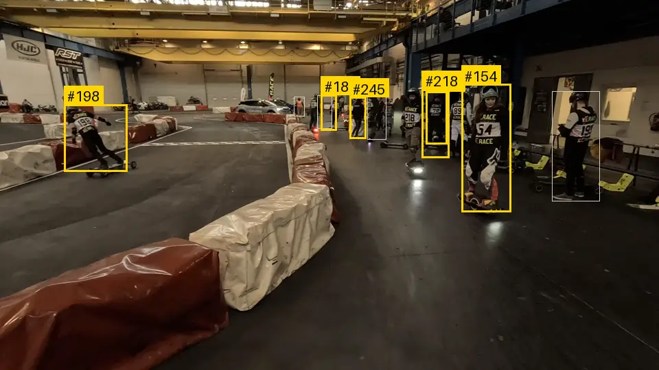
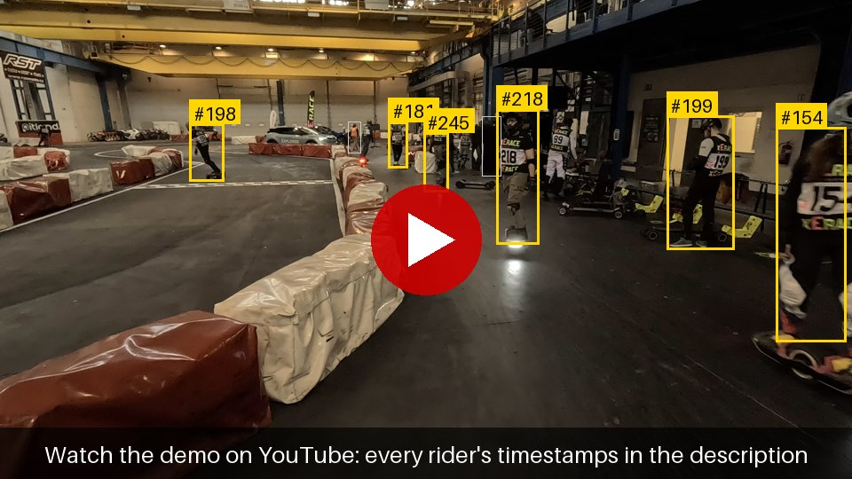
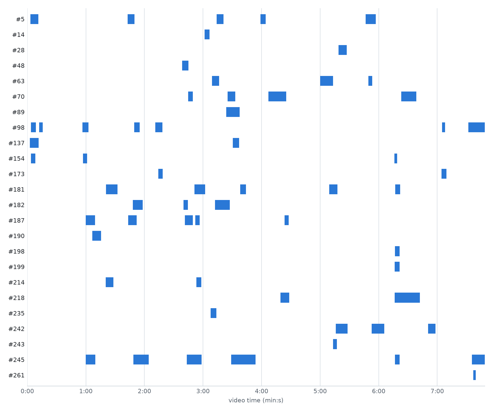
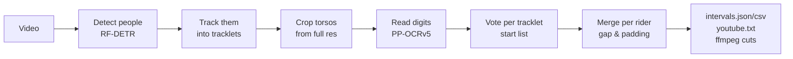
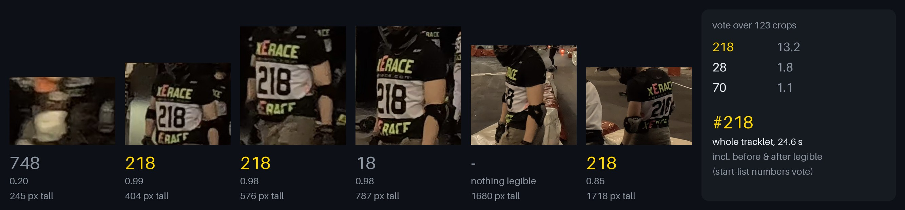

# bibcut

Find every rider in race footage by the start number on their jersey. bibcut tracks people through the video, reads their numbers whenever they become legible, and gives you each rider's on-camera intervals, timestamps for your YouTube video description, and ready-to-run ffmpeg cuts of their moments.

<p align="center">
  <a href="https://youtu.be/j7sgVd98ICA"></a>
</p>
<p align="center"><sub>Real output on trackside footage from an indoor race of electric boards and unicycles (xErace, Prague, 2025). Yellow: riders bibcut identified. The label covers the rider's whole track, including the moments their number cannot be read. Grey: people it tracks but has not identified.</sub></p>

## Demo

The whole 7:49 clip behind these pictures is [on YouTube](https://youtu.be/j7sgVd98ICA). Its **description** is bibcut's unedited `youtube.txt` for it, so every timestamp there is a link that jumps to the moment a rider comes into view. Being raw output, a few links point to the wrong rider (see Status below).

```text
Riders in this video:
- #98: 0:00:03 , 0:00:12 , 0:00:56 , 0:01:49 , 0:02:11 , 0:07:04 , 0:07:31
- #181: 0:01:20 , 0:02:51 , 0:03:38 , 0:05:09 , 0:06:16
- #218: 0:04:19 , 0:06:16
- #245: 0:00:59 , 0:01:48 , 0:02:43 , 0:03:28 , 0:06:16 , 0:07:35
…
```

<p align="center">
  <a href="https://youtu.be/j7sgVd98ICA"></a>
</p>

## Status

It works end to end on real footage (milestone M1, October 2026). On a whole 7.8-minute trackside video, bibcut gave intervals to **23 of the 42 riders** whose numbers are legible in the footage (labelled blind, without bibcut's output), and **1 of the 24 riders it named was wrong**; details and caveats are in [docs/SPEC.md §12](docs/SPEC.md#12-sample-footage-xerace-2025-05-17). It needs a camera at track level: from a spectator gallery, racing riders are side-on and their numbers are rarely visible. Expect rough edges — this is pre-1.0 software.

## Install

You need [uv](https://docs.astral.sh/uv/), Python 3.12+ (uv can install it) and [ffmpeg](https://ffmpeg.org/) with ffprobe on your `PATH`.

```sh
brew install uv ffmpeg            # macOS; on Linux use your package manager
git clone https://github.com/kratocz/bibcut.git
cd bibcut
uv sync
uv run bibcut --help
```

On first use bibcut downloads two models (~130 MB) to `~/.cache/bibcut/models` (override with `BIBCUT_MODELS_DIR`) and checks each against a pinned SHA-256. Everything runs locally on the CPU; on macOS, video decoding and encoding use the hardware media engine (VideoToolbox) automatically.

## Usage

```sh
uv run bibcut intervals race.mp4 --startlist startlist.csv
```

The start list is optional but strongly recommended: a CSV with a `number` column and optionally `name` (other columns are ignored). Only numbers on the list are credited, which filters out many misreadings.

```csv
number,name
7,Jane Doe
218,John Smith
```

This writes to `data/out/race/`:

- `intervals.json` and `intervals.csv` — every rider's appearances; the JSON also lists the tracks it could not identify:

  ```json
  {
    "number": "218",
    "name": "John Smith",
    "appearances": [
      { "start": 259.501, "end": 268.301, "confidence": 0.874, "source": "auto" },
      { "start": 376.502, "end": 402.101, "confidence": 0.774, "source": "auto" }
    ]
  }
  ```

- `youtube.txt` — timestamps to paste into the video's YouTube description, where they become clickable links to each rider's moments (see the [Demo](#demo) above). With names in the start list, a line reads `- #218 John Smith: 0:04:19 , 0:06:16`. If the uploaded video does not start where this one does (an edit, a compilation), shift the timestamps with `--youtube-offset SECONDS`.

- `cuts/rider-<number>.sh` — one ffmpeg command per rider that joins their appearances into a single video:

  ```sh
  sh data/out/race/cuts/rider-218.sh      # → data/out/race/cuts/rider-218.mp4
  ```

All riders of the 7.8-minute sample video on one timeline:

<picture>
  <source media="(prefers-color-scheme: dark)" srcset="docs/media/timeline-dark.png">
  
</picture>

Useful options:

| Option | What it does |
|---|---|
| `--start 120 --end 300` | process only part of the video (seconds) |
| `--config bibcut.toml` | tune `merge_gap` (join appearances closer than this, default 2 s), `padding` (default 0.5 s) and `min_appearance` (default 1 s) |
| `--min-votes 2.0` | how much evidence a number needs before it is credited; lower finds more riders and makes more mistakes |
| `--workdir DIR` | where intermediate results are cached (default `data/work/<video>`); re-runs with other options reuse them |
| `--youtube-offset 95` | add seconds to the `youtube.txt` timestamps, for an upload that starts earlier or later |
| `--hwaccel none` | decode and encode in software (e.g. off macOS or for debugging) |

A 7.8-minute 4K GoPro clip takes about 20 minutes on a MacBook. If a GoPro low-resolution proxy (`.LRV`) sits next to the video, detection uses it and only number reading touches the 4K file. The other commands — `probe`, `track` and `identify` — run the earlier stages alone and print JSON, which helps when tuning.

## How it works



A rider's number is legible only now and then: too far, side-on, blurred, or too close to fit. So bibcut does not label frames, it labels *tracklets* — one person followed continuously. Every torso crop of a tracklet is read, the readings vote, and the winning number is credited for the tracklet's whole length:

<p align="center">
  
</p>

Tracklets with the same number are merged into the rider's timeline. Tracks whose readings are too weak to credit a number end up in the `unresolved` list instead of being guessed; tracks with no reading at all are left out.

## Limits

- Numbers have to face the camera at some point: trackside or finish-line cameras work, a gallery view of a whole circuit does not.
- Motion blur limits reading more than resolution does; a faster shutter should help.
- An incomplete start list hurts: a rider missing from it can be credited to a listed number that matches part of theirs (263 → 63).
- When two riders cross, a tracklet can switch from one to the other, and the cut then holds a few seconds of someone else.

## Privacy

bibcut identifies people only by the number they wear. There is no face recognition, nothing leaves your machine, and the models are run locally.

## Roadmap

Next (M2): a review step for unresolved tracks and doubtful numbers, and a "near camera" mode that keeps only the moments a rider is close. See [docs/SPEC.md](docs/SPEC.md) for the design and the milestones.

## Contributing

Issues are welcome, especially about footage where bibcut does poorly: describe the camera position, resolution and frame rate, and attach frames only if you are allowed to share them.

Pull requests are welcome too. Before sending one:

- run `uv run pytest`, `uv run ruff check` and `uv run ruff format`;
- add no dependency or code under GPL, AGPL or a non-commercial license, including native libraries a package's wheels bundle (which rules out PyAV and OpenCV);
- never commit videos, frames, crops, start lists with names or model weights — tests use small synthetic videos generated on the fly.

[AGENTS.md](AGENTS.md) has the full rules and the project layout (it is written for coding agents but applies to people as well), and [docs/SPEC.md](docs/SPEC.md) the design; if a change goes against the spec, update the spec in the same pull request or open an issue first.

## License

[MIT](LICENSE) © 2026 Petr Kratochvil

bibcut downloads model weights, it does not ship them: RF-DETR Small (Apache-2.0; a third-party ONNX export of Roboflow's model) and PaddlePaddle's PP-OCRv5 English recognizer (Apache-2.0). ffmpeg is called as an external program.
